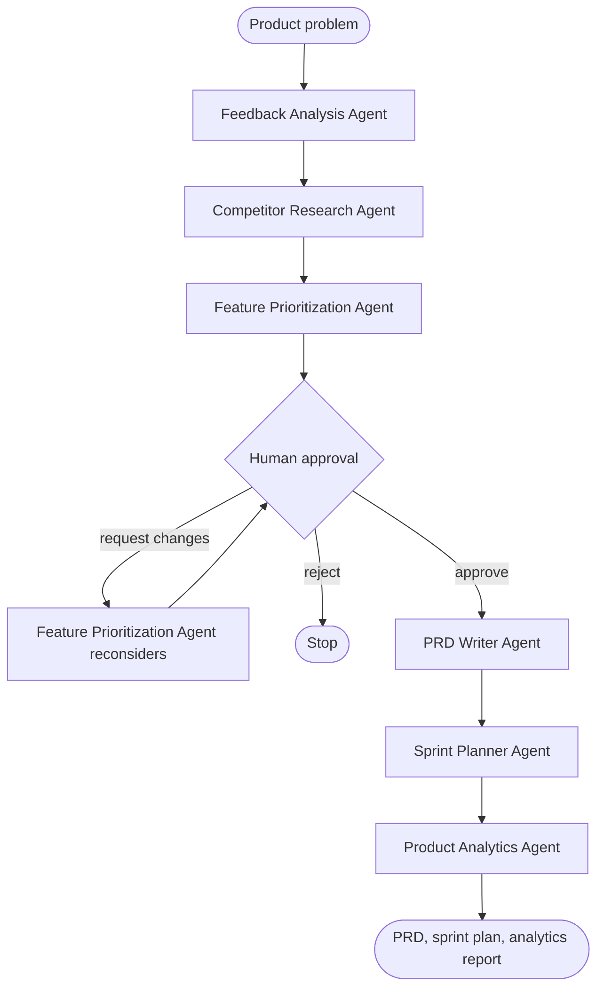

# ProductPilot AI

ProductPilot AI is a multi-agent assistant for product managers. Given one product problem, it analyzes customer feedback, looks at competitors, ranks possible features, asks a human for approval, and then writes a PRD, a sprint plan and an analytics report for the approved feature.

The demo product is StudyFlow, a fictional student productivity app. All datasets are synthetic.

Example input:

> StudyFlow users are missing deadlines. We need to improve student productivity and engagement. What should we build next?

## How it works



A Python orchestrator runs the agents in order and passes each agent's output to the next one. Progress is saved to `workflow_state.json` after every stage, so a run that stops (for example because of the API quota) can be resumed.

## Agents and tools

| Agent | What it does | Tools |
|---|---|---|
| Feedback Analysis | Finds the main complaints and requested features | `read_customer_feedback`, `get_feedback_statistics` |
| Competitor Research | Compares StudyFlow with three fictional competitors | `get_competitor_data` |
| Feature Prioritization | Ranks the features and explains the trade-offs | `calculate_feature_priority` |
| PRD Writer | Writes and saves the PRD for the approved feature | `save_prd` |
| Sprint Planner | Reads the approved PRD and plans the tasks | `read_approved_prd` |
| Product Analytics | Calculates product metrics and suggests KPIs | `calculate_product_metrics` |

The tools are Python functions registered with `@function_tool` from the OpenAI Agents SDK. Human approval is a separate checkpoint, not an agent.

## Feature prioritization

Priority = 0.40 x Demand + 0.25 x Competitor gap + 0.20 x Business value + 0.15 x Implementation ease

- Demand: how many feedback records ask for the feature, compared to the most requested one
- Competitor gap: how many competitors offer a feature that StudyFlow doesn't have
- Business value: from `engineering_estimates.csv` (1 to 10)
- Implementation ease: features with less effort score higher

The scores are calculated in Python, not by the model. Result for StudyFlow:

| Rank | Feature | Score |
|---|---|---|
| 1 | Deadline Reminders | 8.34 |
| 2 | Calendar | 6.75 |
| 3 | Performance & Stability | 5.49 |
| 4 | Dark Mode | 4.59 |
| 5 | Cross-Device Sync | 4.07 |
| 6 | Study Hour Tracking | 2.75 |
| 7 | Study Progress Dashboard | 2.70 |

## Human approval

After ranking, the workflow stops and asks the user to:

1. Approve the recommended feature
2. Reject it (the workflow stops and no documents are created)
3. Request changes

When changes are requested, the Feature Prioritization Agent reconsiders using the user's comment and returns a structured result (a Pydantic model with the recommended feature, decision, reasoning and trade-offs). The user then decides again. Up to 3 revision rounds are allowed. The PRD tools refuse to work on any feature that has not been approved.

## Checks against unreliable output

While building this, the agents sometimes skipped their tools, invented numbers, or returned broken output, so I added these checks:

- After each agent run, the notebook checks which tools were actually called. If a required tool was skipped or failed, the agent is asked again with the reason.
- The analytics report must contain the exact calculated metrics, and the PRD must contain all required sections.
- The datasets are validated before use (columns, missing values, duplicates, value ranges).
- Old output files are archived at the start of each run so they can't be mixed up with new ones.
- An offline test cell checks the tools and scores without making any API calls.

## Demo run

The folder `reports/calendar_demo_run/` contains the unedited output of a real run with Gemini 2.5 Flash Lite:

1. The agents recommended Deadline Reminders (8.34).
2. I requested changes three times:
   - "Reconsider Calendar because students need better scheduling." The agent recommended Calendar.
   - "Calendar takes 10 days and our next release is in one week..." The agent went back to Deadline Reminders.
   - "Reconsider Calendar because students need better scheduling." The agent recommended Calendar.
3. I approved Calendar (6.75), and the remaining agents created:
   - [Calendar PRD](reports/calendar_demo_run/calendar_prd.md)
   - [Calendar sprint plan](reports/calendar_demo_run/calendar_sprint_plan.md)
   - [Calendar analytics report](reports/calendar_demo_run/calendar_analytics_report.md)

The earlier stage outputs and the full `workflow_state.json` are in the same folder.

## How to run

1. Open `ProductPilot_AI_Working.ipynb` in Google Colab.
2. Add your Gemini API key in Colab Secrets as `GEMINI_API_KEY` and turn on notebook access.
3. Run all cells. If the CSV files are missing, they are downloaded from this repository.
4. Type 1, 2 or 3 at the approval prompt.
5. If the run stops because of the Gemini quota, run the Resume cell later.

A full run uses about 13 to 17 Gemini requests.

## Project structure

```text
ProductPilot-AI/
├── ProductPilot_AI_Working.ipynb   main notebook
├── ProductPilot_AI.ipynb           earlier development notebook
├── customer_feedback.csv
├── competitor_data.csv
├── engineering_estimates.csv
├── product_analytics.csv
├── requirements.txt
└── reports/calendar_demo_run/      outputs of the demo run
```

## Tech stack

Python, Google Colab, OpenAI Agents SDK, Gemini 2.5 Flash Lite (OpenAI-compatible endpoint), Pandas, Pydantic

## Limitations

- The ranking depends only on the datasets. The problem statement affects the analysis and the documents, but not the scores. Extra business context comes from the human through "request changes".
- The data setup is specific to StudyFlow (CSV columns, feature-to-competitor mapping, analytics columns). Making this configurable would let it work for other products.
- The datasets are small and synthetic, so this is a prototype, not a production tool.
- Study Progress Dashboard has no competitor data, so its competitor gap score is 0.
